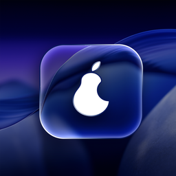
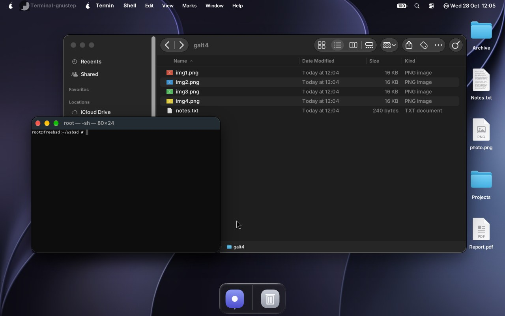
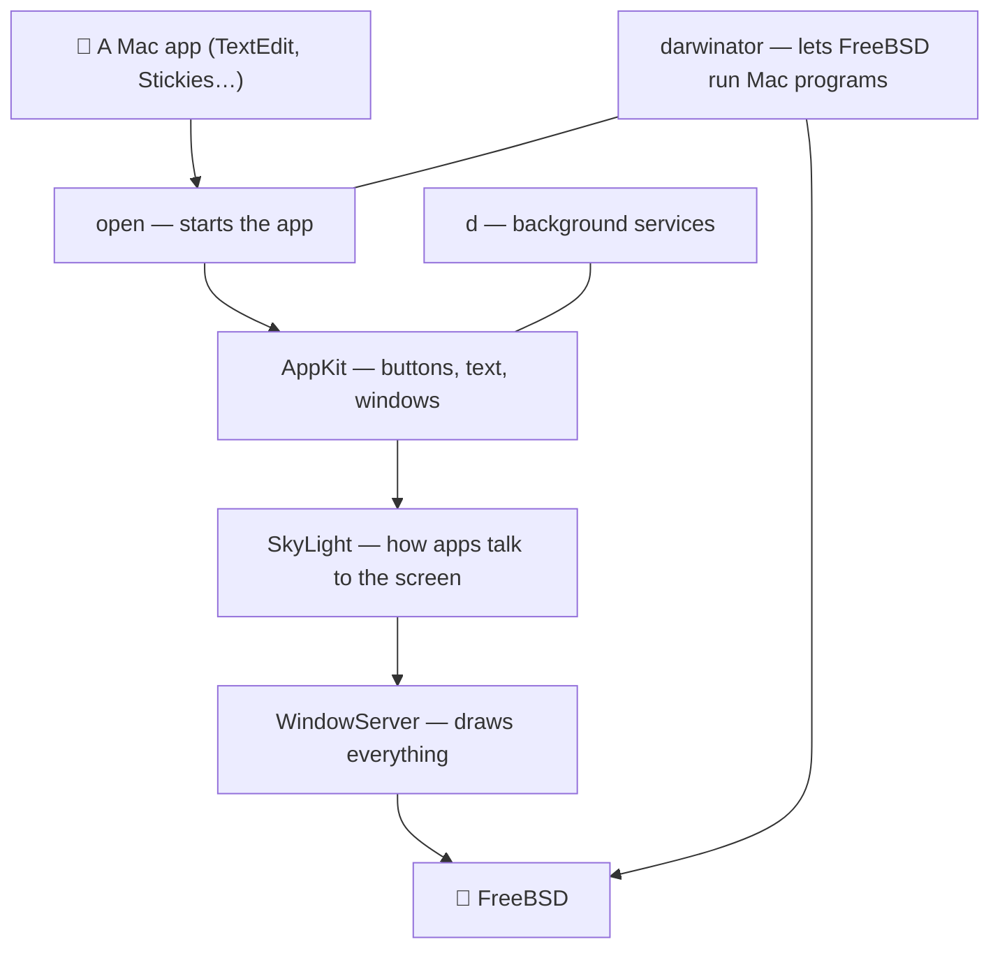

# pearOS BSD

**A Mac-style desktop that runs on FreeBSD — and runs real Mac apps.**

---

## In one minute

**pearOS BSD** looks and feels like a Mac, but it is free, open and runs on **FreeBSD** (a fast, stable, grown‑up operating system).

We build all the pieces ourselves:

- 🪟 a **window server** that draws windows, menus and the Dock,
- 🍎 an **AppKit** — the part of macOS that apps use to make buttons, text and windows,
- 🚀 a way to **open Mac apps** on it: `open Notes.app`,
- 🧰 the **background services** a Mac needs (preferences, icons, notifications, Wi‑Fi…).

> Think of it as a Mac‑shaped house built on a very strong BSD foundation.

---

## How the pieces fit

---

## The repositories (in plain words)

| | Repository | What it is |
|---|---|---|
| 🧠 | [**darwinator**](https://github.com/pearOS-bsd/darwinator) | Teaches FreeBSD to run programs made for a Mac. |
| 🪟 | [**WindowServer**](https://github.com/pearOS-bsd/WindowServer) | The screen: windows, mouse, keyboard, animations. |
| ✨ | [**SkyLight**](https://github.com/pearOS-bsd/SkyLight) | The “language” apps use to ask the screen for a window. |
| 🧩 | [**AppKit**](https://github.com/pearOS-bsd/AppKit) | The toolbox for buttons, menus and text — our own copy. |
| 🚀 | [**open**](https://github.com/pearOS-bsd/open) | `open SomeApp.app` — starts a Mac app on pearOS. |
| ⚙️ | [**d**](https://github.com/pearOS-bsd/d) | Services that run quietly in the background. |
| 💿 | [**iso**](https://github.com/pearOS-bsd/iso) | Builds the installer disk image. |
| 🥾 | [**ploader**](https://github.com/pearOS-bsd/ploader) | The boot screen. |
| 📦 | [**pkgbuild**](https://github.com/pearOS-bsd/pkgbuild) · [**package-repo**](https://github.com/pearOS-bsd/package-repo) | Where software packages come from. |
| 🛍️ | [**AppStore-Backend**](https://github.com/pearOS-bsd/AppStore-Backend) | The server behind the App Store. |
| 🎮 | [**virtio**](https://github.com/pearOS-bsd/virtio) · [**clevo_wmi**](https://github.com/pearOS-bsd/clevo_wmi) | Drivers (virtual graphics, Clevo keyboard lights). |
| 🗃️ | [**misc**](https://github.com/pearOS-bsd/misc) | Everything not moved yet — it is being tidied up. |

---

## Featured

  
  

  
  

---

## The project in numbers

  
  

  

### Activity

  

### Growth

  

### Made by

  

---

## Want to help?

1. ⭐ **Star** the repositories you like — it really helps.
2. 🐛 **Try it** in a virtual machine and tell us what breaks (open an *Issue*).
3. 🛠️ **Pick a small task** — every repo has a README that says how to build it.

**Made with ❤️ for people who like Macs, BSD, and understanding how things work.**

